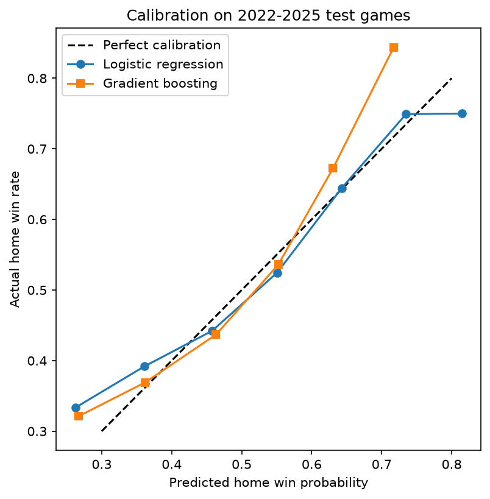

# NHL Game Outcome Prediction

Predicting NHL regulation/overtime game winners from pre-game team form, using expected-goals (xG) features and an Elo rating system. Models are evaluated on seasons they never saw during training.

## Results (test set: 2022-2025 seasons, ~4,900 games)

| Model | Accuracy | Log loss |
|---|---|---|
| Always pick home team | 54.1% | n/a |
| Elo (tuned by hand, not on test data) | 58.8% | 0.6684 |
| Logistic regression (rolling xG/shot features) | 58.5% | 0.6682 |
| Gradient boosting | 57.4% | 0.6744 |
| **Logistic regression + Elo** | **59.8%** | **0.6623** |



## Approach

1. **Data:** Game-by-game team data (2008-2025 seasons) from MoneyPuck.com, filtered to regular-season, all-situations rows (one row per team per game).
2. **Target:** Whether the home team won. Shootout games are excluded as prediction targets because the data doesn't show who won them, but they are still used when computing team form and Elo ratings.
3. **Features:** Rolling 10-game averages of xG, goals, shots on goal, and high-danger shots (for and against) for both teams, plus rest days. Averages are shifted by one game so a game's own result is never used to predict itself.
4. **Validation:** Time-based split. Trained on 2008-2021, tested on 2022-2025. No random splitting.
5. **Models:** Always-home baseline, Elo, logistic regression, gradient boosting, and a combined model using Elo's win probability as an extra feature.

## Findings

- All models beat the home-ice baseline by roughly 3.5 to 5.8 accuracy points.
- Logistic regression outperformed gradient boosting. With ~14,000 training games and a high-noise sport, the added flexibility mostly fit noise.
- xG features alone roughly matched Elo; combining them gave the best log loss, suggesting the two capture partly different information.
- Predicted probabilities track actual win rates (see calibration plot).

## Limitations

- No goalie, lineup, injury, or travel information.
- Only regulation/overtime games are predicted.
- One train/test split; no confidence intervals on the metrics yet.
- Not compared against betting market odds.
- Hockey is a high-variance sport, so accuracy in the high 50s is a realistic ceiling for this kind of data.

## Reproducing

```
pip install -r requirements.txt
```
Download the game-by-game data from [MoneyPuck](https://moneypuck.com/data.htm) into a `data/` folder (not included in this repo), then run `notebooks/01_explore_data.ipynb`.

## Data credit

Data from [MoneyPuck.com](https://moneypuck.com), used for non-commercial purposes.